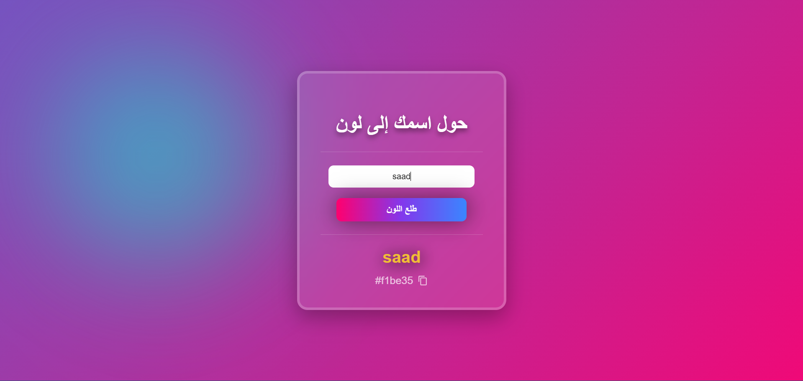

# 🎨 Name to Color Generator

A modern interactive web app that converts any name into a unique HEX color using a custom hashing algorithm.

## ScreenShot:

---

## 🚀 Features
s
- 🔤 Convert any name into a unique HEX color
- 🎨 Dynamic color preview
- 📋 Copy-to-clipboard functionality
- ⚠ Input validation with visual feedback
- ✨ Smooth animations and glow effects
- 📱 Responsive design
- 🌈 Animated gradient background with glass UI

---

## 🛠 Technologies Used

- HTML5
- CSS3 (Flexbox, Animations, Glassmorphism)
- Vanilla JavaScript (DOM manipulation, Events, Clipboard API)

---
